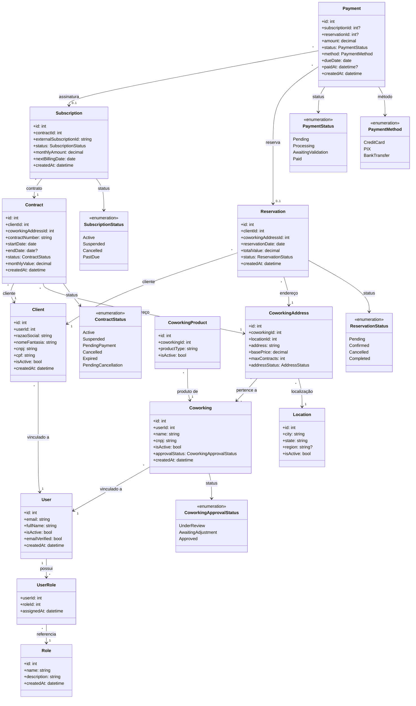

# Diagrama de Classes (Baseado nas US)

Este diagrama foi derivado das User Stories em `docs/us/` e representa uma visão de domínio de alto nível do **Klyon Hub Platform**.

## Diagrama Draw.io

Arquivo fonte: [diagrama-classes-us.drawio](./diagrama-classes-us.drawio). Pode ser editado no [draw.io](https://app.diagrams.net/) ou no VS Code com extensão Draw.io.

## Visão em Mermaid

## Observações

- O modelo representa classes de domínio sugeridas pelas US e pelo código em `KlyonHubPlatform.Domain` e não substitui o modelo técnico final.
- Campos e relacionamentos podem ser refinados conforme regras de negócio detalhadas e decisões de implementação.
- A aplicação segue arquitetura em camadas (Api, Application, Domain, Infra.Data, Infra.CrossCutting); as entidades acima pertencem ao **Domain**.
